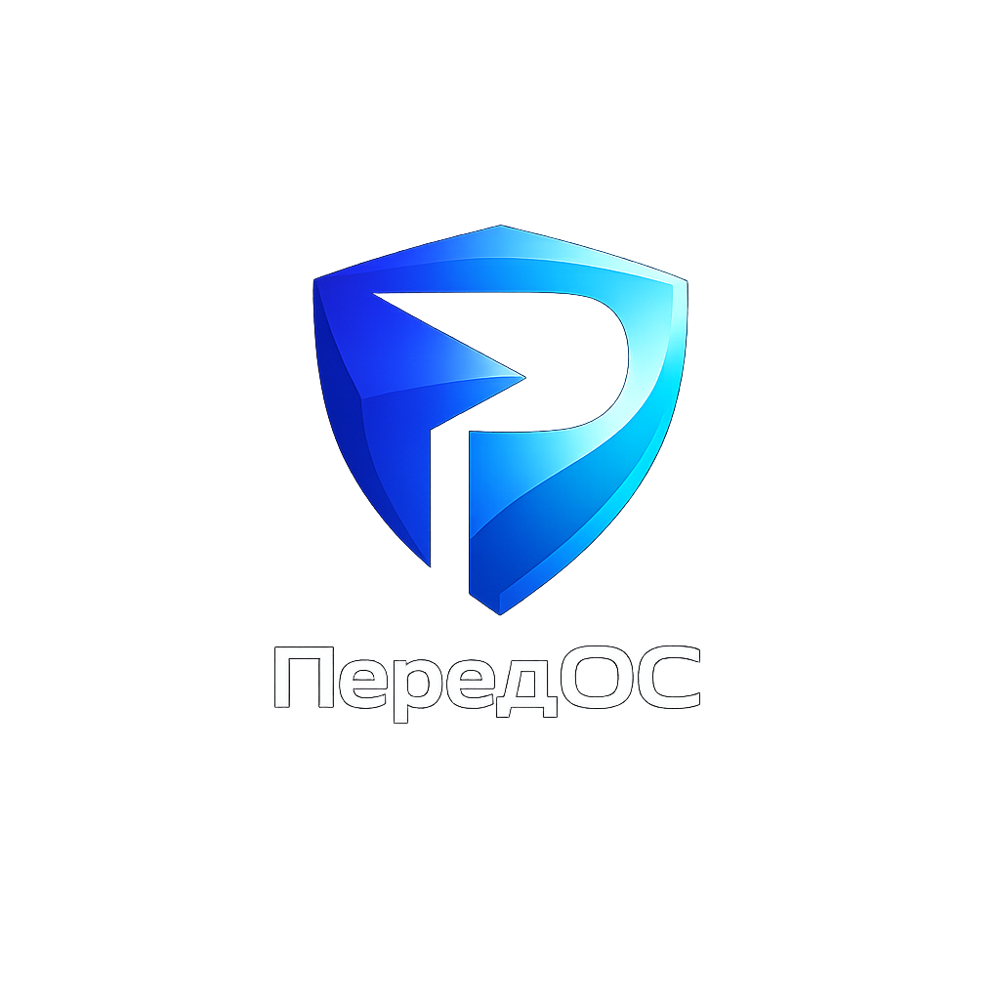

# ПередОС 1.0 "Pioneer"

> Передовая операционная система от НПО "всё ПО"



## Описание

**ПередОС** — это современная Linux-система, построенная на базе Debian 12 (Bookworm) с ядром Linux 6.1 LTS и рабочим столом GNOME 43. ОС разработана с фокусом на безопасность, производительность и минималистичный дизайн.

> **Статус:** прототип. Сейчас собирается live-образ для amd64 (UEFI и BIOS). Установщика, собственных пакетов и темы GRUB пока нет.

### Уникальные технологии

- **ПередЗащита** — firewalld, fail2ban, auditd, Flatpak; SELinux установлен, но не активирован
- **ПередСкорость** — настройки sysctl (BBR, swappiness), Btrfs с zstd в шаблоне fstab
- **ПередДизайн** — современный интерфейс GNOME с адаптивными темами
- **ПередЦентр** — единый центр управления системой

## Структура проекта

```
peredos/
├── build.sh              # Скрипт сборки ISO
├── docs/
│   └── MANIFEST.md       # Манифест ОС
├── branding/
│   ├── logo.png          # Логотип ПередОС
│   └── wallpapers/       # Обои рабочего стола
│       ├── default-dark.jpg
│       └── default-light.jpg
├── rootfs/               # Корневая файловая система
│   ├── etc/
│   │   ├── apt/          # Настройки репозиториев
│   │   ├── default/grub  # Конфигурация загрузчика
│   │   ├── fstab         # Шаблон fstab для установщика (в live не копируется)
│   │   ├── hostname      # Имя хоста
│   │   ├── modules-load.d/ # Загрузка модуля tcp_bbr
│   │   ├── os-release    # Информация об ОС
│   │   ├── sysctl.d/     # Настройки ядра
│   │   └── systemd/      # resolved, timesyncd, peredos-firstboot.service
│   └── usr/lib/peredos/  # firstboot — скрипт первой загрузки
└── build/                # Результат сборки (в git не попадает)
```

## Системные требования

| Уровень | Процессор | ОЗУ | Диск | Графика |
|---------|-----------|-----|------|---------|
| Минимальные | 2 ядра, 1.5 GHz | 4 GB | 25 GB SSD | DirectX 11 / Vulkan 1.1 |
| Рекомендуемые | 4+ ядра, 2.5 GHz | 8+ GB | 50+ GB NVMe SSD | Vulkan 1.3+ |
| Оптимальные | 8+ ядер, 3.5 GHz | 16+ GB | 100+ GB NVMe SSD | Dedicated GPU |

## Сборка из исходников

### Требования

- Debian/Ubuntu-based система на x86_64
- Права root (sudo)
- Интернет-соединение
- ~10 GB свободного места

### Установка зависимостей

```bash
sudo apt-get update
sudo apt-get install -y debootstrap grub-pc-bin grub-efi-amd64-bin grub-common \
    xorriso mtools squashfs-tools
```

### Запуск сборки

```bash
# Полная сборка (пароль пользователя user задаётся переменной)
cd peredos
sudo PEREDOS_PASSWORD='ваш_пароль' ./build.sh

# Только определённый этап
sudo ./build.sh --stage 1  # Базовая система
sudo ./build.sh --stage 2  # Конфигурации
sudo ./build.sh --stage 3  # Пакеты
sudo ./build.sh --stage 4  # Брендинг
sudo ./build.sh --stage 5  # Initramfs
sudo ./build.sh --stage 6  # ISO
sudo ./build.sh --stage 7  # Очистка монтирований

# Очистка
sudo ./build.sh --clean
```

Репозиторий `repo.peredos.vsepo.ru` подключается только при наличии ключа `branding/peredos-archive-keyring.gpg` (или пути из `PEREDOS_REPO_KEY`).

Результат сборки: `build/peredos-1.0-pioneer-amd64.iso`

## Установка

### Создание загрузочного USB

```bash
# С помощью dd
sudo dd if=peredos-1.0-pioneer-amd64.iso of=/dev/sdX bs=4M status=progress

# Или с помощью Ventoy (рекомендуется)
# Просто скопируйте ISO на флешку с Ventoy
```

### Запуск

1. Загрузитесь с USB-накопителя.
2. Выберите пункт меню ПередОС. Система стартует в live-режиме, пользователь `user` входит автоматически.
3. Установщика пока нет. Шаблон разметки лежит в `/usr/share/peredos/fstab.template`.

## Технический стек

- **Ядро:** Linux 6.1 LTS из Debian 12 (только x86_64)
- **База:** Debian 12 Bookworm
- **Инициализация:** systemd
- **Графика:** GNOME 43, Wayland/Xorg через GDM
- **Аудио/Видео:** PipeWire
- **ФС:** Btrfs с zstd (шаблон fstab); live-образ — SquashFS
- **Безопасность:** firewalld, fail2ban, auditd, Flatpak, SELinux (пакеты установлены, не активирован)
- **Сеть:** NetworkManager + systemd-resolved (DNS-over-TLS в режиме opportunistic)

## Лицензия

GPL v3 — свободное программное обеспечение

## Контакты

- **Организация:** НПО "всё ПО"
- **Сайт:** https://peredos.vsepo.ru
- **Поддержка:** support@vsepo.ru
- **Разработка:** dev@vsepo.ru

---

*ПередОС — технологии будущего, доступные сегодня.*
*© 2025 НПО "всё ПО"*
